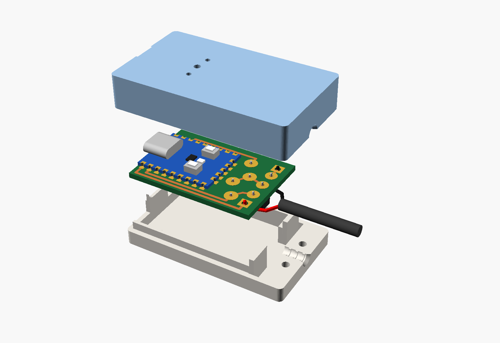
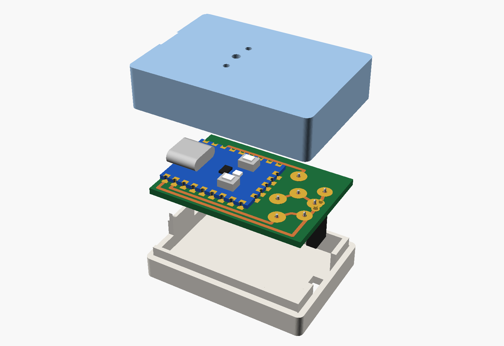
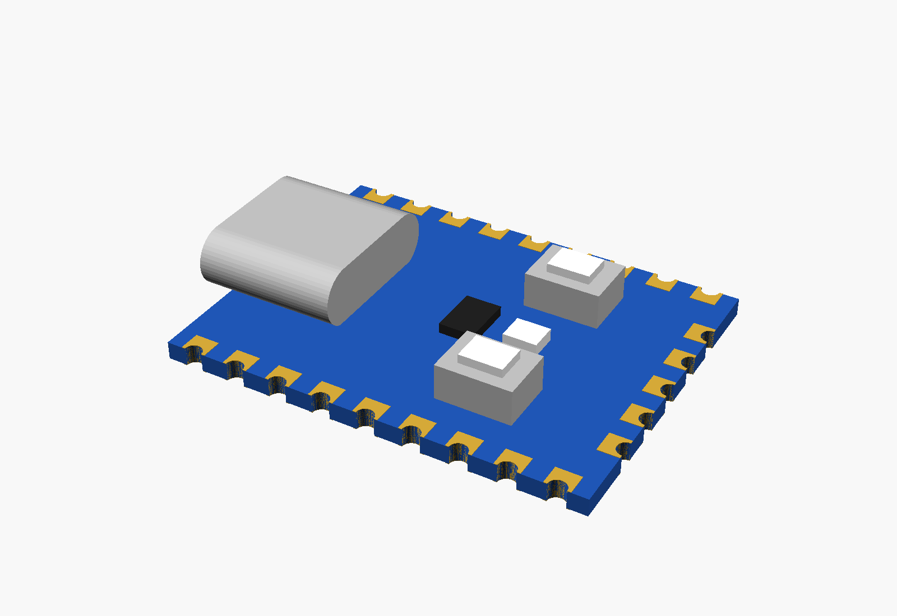
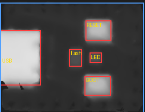
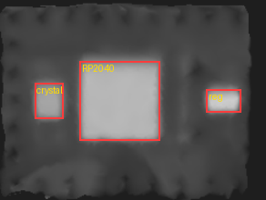
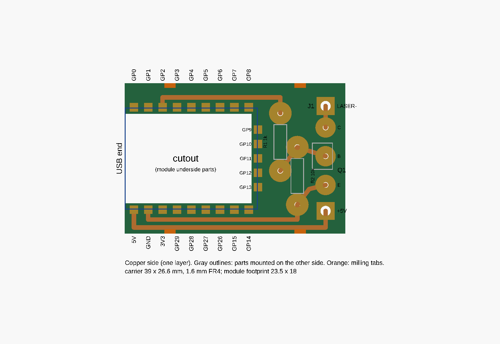
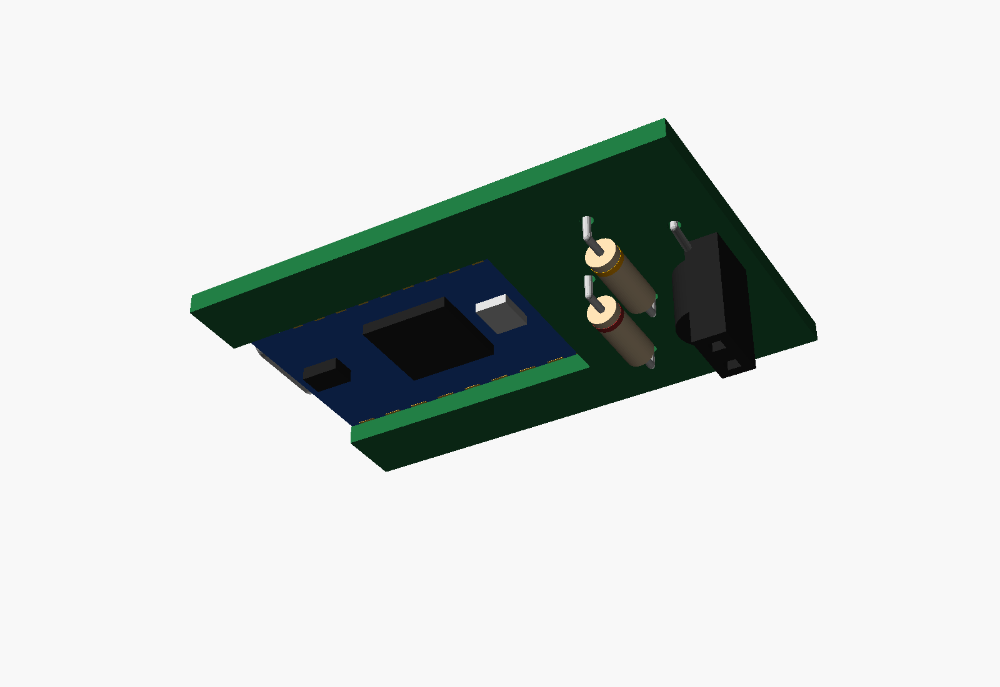
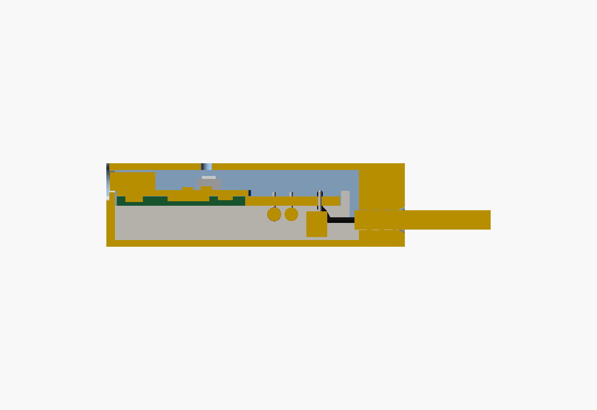
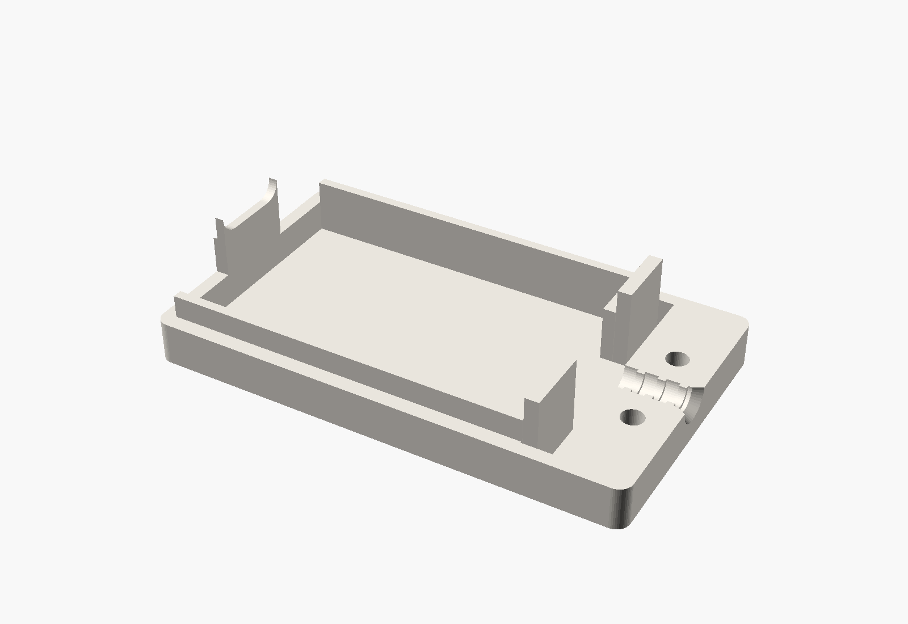
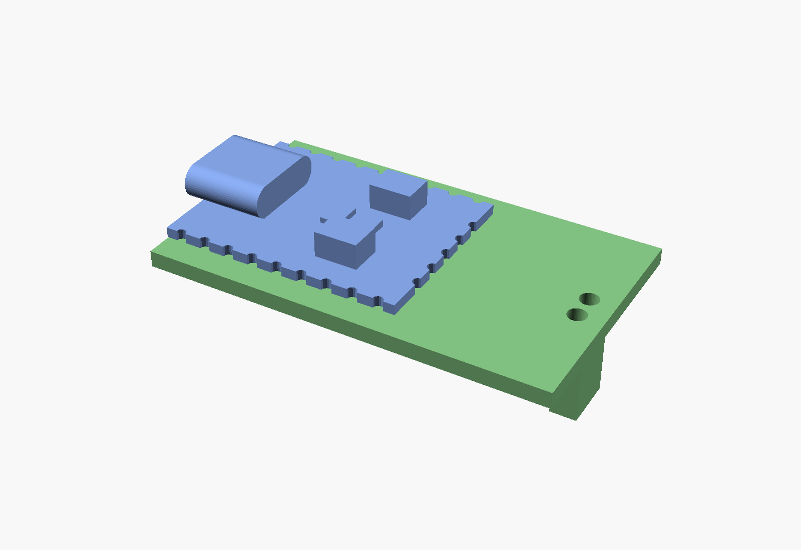

# Carrier board and case mockup

A parametric OpenSCAD model of the whole assembly: the RP2040-Zero, a
single-sided through-hole carrier board that holds the module and the
laser switch circuit ([circuit.md](circuit.md)), and a two-piece printed
case in two versions.

- Model: [cad/usb_power_switch.scad](cad/usb_power_switch.scad). Every dimension
  is a named parameter at the top of the file.
- `just render` writes preview images to `cad/renders/`.
- `just stl` writes printable STLs to `cad/stl/`. The lids are already
  flipped upside down for printing.
- `just viewer` builds interactive 3D views, where each part can be turned
  on, ghosted or hidden:
  [cable version](https://busboombot.github.io/usb-power-switch/viewer/cable.html),
  [Molex version](https://busboombot.github.io/usb-power-switch/viewer/molex.html).

| | Molex version | Cable version |
|---|---|---|
| Laser connection | Vertical 2-pin 0.1" female header. It hangs under the board and plugs in **from the bottom of the case** | AM2464 cable (2 × 20 AWG, 3.4 mm) soldered into the board |
| Closing the case | Glue | 2 × M2×8 self-tapping screws, put in from the bottom through the cable clamp |
| Outside size (L × W × H) | 42.6 × 30.2 × 15.65 mm | 52.1 × 30.2 × 14.65 mm |

## RP2040-Zero (as modelled)

The part positions come from a 3D scan of the module
([scan/rp2040-zero-scan.stl](scan/rp2040-zero-scan.stl)). The scan has
two patches, the top and the bottom. Each was laid flat and turned into
a height map, and the raised parts were measured from those maps.

| Top-side model outlines on the scan | Bottom-side model outlines on the scan |
|---|---|
|  |  |

- **Board** 23.5 × 18 × 1.0 mm. The scan measures 23.53 × 18.18,
  matching Waveshare's drawing.
- **Castellations** at 2.54 mm pitch: 9 on each long side, 5 on the end
  opposite the USB. Long side: 5V, GND, 3V3, GP29, GP28, GP27, GP26,
  GP15, GP14 (starting at the USB end). Other long side: GP0–GP8. End:
  GP9–GP13. The scan is too coarse to show the half-holes, so the model
  assumes each row is centered along its edge.
- **Top side** (x from the USB end, y from the centerline):

  | Part | Center (x, y) | Size | Height above board |
  |------|---------------|------|--------------------|
  | USB-C | runs from 1.25 past the edge back to x = 6.7, centered | 8.94 wide | 3.15 |
  | BOOT button (5V side) | 16.0, −4.6 | 4.2 × 3.2 | 2.5 |
  | RESET button (GP0 side) | 16.1, +4.45 | 4.2 × 3.2 | 2.5 |
  | RGB LED | 15.65, 0 | 1.9 × 1.6 | 0.7 |
  | Flash chip | 12.4, 0 | 2.0 × 2.9 | 0.56 |

  The two buttons sit side by side at the same distance from the USB,
  with the LED between them. The USB-C is the tallest part on top,
  0.65 mm taller than the buttons.
- **Bottom side:** RP2040 (7.3 × 7.3 × 0.92, center 12.55 from the USB
  end), crystal (2.6 × 3.3 × 0.76, at 19.0), and voltage regulator
  (3.1 × 2.1 × **1.05**, at 3.05). The underside parts stand up to
  1.05 mm, not 0.5. They all sit inside the carrier's cutout, which is
  1.6 mm deep, so this doesn't change the carrier.

## Carrier board

**Single-sided, through-hole.** 39 × 26.6 mm, 1.6 mm FR4, copper on one
side only.

- **Which side is which.** The module solders to the copper side, so the
  through-hole parts go on the plain side. Their leads push up through
  the board and are soldered on the copper side, next to the module.
  Every solder joint is on the same side.
- **Module footprint.** Pads for all 23 castellations, even though only
  5V, GND and GP2 are used; the rest hold the module down. Each pad runs
  0.7 mm under the module edge and 0.8 mm past it for the solder fillet.
- **Cutout.** Inside the 1.1 mm pad band, the board is cut away so the
  module's underside parts have room. The cutout runs out through the USB
  end of the carrier. The module therefore sits flat on the pads.
- **Routing on one layer, with no crossings.** 5V and GND both leave the
  module on the same side and run side by side to the back, outside the
  pad row: 5V in the outer lane, GND in the inner one. GP2 runs down the
  other side. That's why the board is 4.3 mm wider than the module on
  each side. Traces are 0.8 mm.
- **Made for milling, with no solder mask.** Along the lanes and the
  castellation pads, copper of different nets is at least 0.6 mm apart
  (`iso_gap`). Among the through-hole parts it is at least 1.2 mm apart
  (`tht_gap`). A 30° × 0.2 mm V-bit cuts about 0.25 mm wide, so every net
  is isolated by its first pass. All the other copper is milled off, so
  there's nothing left for solder to bridge to: a 1 mm flat end mill
  clears the open areas, and the V-bit cuts extra rings in the gaps too
  narrow for it. The outer lane stays 0.7 mm back from the long edges (`edge_cu`)
  and 0.4 mm back from the module cutout, which the 2 mm cutter mills.
  The toolpaths come from `just cam` (`tools/mill/cam.py`).
- **Milling tabs** (`tabs`, orange in the drawing): four, 2 mm wide and
  0.5 mm thick, two on each long side at 8 and 31 mm from the USB end.
  None on the back edge, where the cable version's back stops sit, or on
  the USB end. Cut them with flush cutters and sand flush: the case leaves
  only 0.3 mm round the carrier.
- **Through-hole pads** are 4.0 mm across for R1 and R2 and 3.6 mm for
  Q1, with 1.0 mm holes. They're big because the holes on a single-sided
  board aren't plated, so all the strength comes from the copper's grip on
  the board.
- **J1 (cable version)** is two 1/8" (3.175 mm) square pads at the back
  corners, each with a 1.8 mm hole for a wire up to about 0.04" (1 mm)
  across. Push the wire up through the hole and solder it there, or lap it
  flat onto the square. +5V is the bottom square (the 5V lane runs into
  it); LASER− is the top one, joined to Q1's collector by a short trace.

| Ref | Part | Mounting |
|-----|------|----------|
| R1 | 1 kΩ, 1/4 W axial | Lying flat, 10.16 mm (0.4") hole spacing, at x = 27.5 |
| R2 | 10 kΩ, 1/4 W axial | Lying flat, 10.16 mm hole spacing, at x = 30.5 |
| Q1 | 2N3904 or PN2222A, TO-92 | Standing at the back, legs spread to 5.08 mm (0.2"), order **E-B-C** |
| J1 | The two cable wires (cable version) | 1.8 mm holes in 1/8" square pads, 18.5 mm apart. Pin 1 = +5V, pin 2 = LASER− |

**Q1's legs** leave the body 1.27 mm apart and must be bent out to 5.08 mm:
bend the two outer legs out about 3.8 mm just below the body, then down
through the holes. Leave the body about 1 mm off the board; the case has
6 mm of room under the carrier.

**Molex version: not redone.** The vertical header still sits where it
used to, which is now Q1's spot. Only the cable version has the new
layout.

**Check Q1's pinout.** 2N3904 and PN2222A in TO-92 are E-B-C, reading
left to right with the flat face toward you and the legs down. Some parts
sold as "2N2222" in TO-92 are C-B-E, which would fit the board backwards.

### Build order

1. Put R1, R2 and Q1 in from the plain side (and the header, for the
   Molex version). Bend the leads over a little so the parts stay put.
2. Turn the board copper side up. Solder and trim the leads.
3. Set the module on its pads, lined up with the USB end of the carrier,
   and solder the castellations.
4. Cable version: push the two wires up through J1 from the plain side
   and solder them on the copper side.

You turn the board over once, after step 1, and do all the soldering
from then on without turning it again.

## Case

Section through the middle (cut surfaces shown in gold). Left to right:
USB opening, module on the carrier, R1 and R2 under the board, Q1
standing, the wires coming up into J1, and the cable clamp.

- **Two halves.** They meet at a flat plane 2.5 mm below the carrier,
  through the middle of the cable, so each half clamps half of it. Under
  the USB opening, a tab on the bottom half rises to the middle of the
  receptacle. That lets the lid come straight down over the USB-C, which
  sticks out into the front wall.
- **Depth.** 6 mm of room under the carrier for the standing TO-92 (about
  5.5 mm). This is what sets the overall height.
- **Walls** 1.5 mm, floor and lid 1.2 mm. 0.3 mm clearance around the
  carrier.
- **Carrier support.** Rails along both sides and at the back corners hold
  the carrier up. They stand 2.5 mm above the split, which locates the
  lid. The middle of the back is left open for the cable's wires. Two
  posts in the lid press down on the carrier's back corners.
- **Back stops (cable version).** Behind the carrier there is a 3 mm gap
  where the wires turn up into J1. Two posts at the back corners close it
  off: they rise from the floor to 1 mm above the top of the carrier, 0.2 mm
  behind its back edge, so the board can't slide back. They sit at
  |y| ≥ 6 mm, clear of the wires and the clamp screws. The front wall and
  the USB-C in its slot stop the board moving forward. The Molex version's
  back wall is only 0.3 mm behind the board, so it needs no stops.
- **USB opening:** 9.4 × 3.8 mm, rounded to match the receptacle, with a
  12 × 6.6 mm recess 0.5 mm deep around it. The receptacle face ends up
  0.55 mm behind the case surface, so the plug seats fully.
- **Lid holes:** a 2 mm window over the RGB LED, and 1.5 mm pinholes over
  BOOT and RESET (for a paperclip).
- **Molex version:** the floor is 2.2 mm thick, so the bottom of the
  case is flat. The header comes out through a hole in the floor and
  stands 0.3 mm above it, so the mating plug seats fully. A raised box
  under the floor would have had to print in mid-air.
- **Cable version:** a clamp block 8 mm long at the back end. The channel
  is 3.5 mm across, with three ridges that narrow it to 2.7 mm and bite
  into the 3.4 mm jacket. Two M2×8 self-tapping screws go up from the
  bottom: the heads sit in 4.2 mm counterbores, and the screws bite into
  1.7 mm pilot holes in the lid.

## Fit-test mockups

`just stl` also writes two printable stand-ins for testing the case
before the real board exists:

- `carrier_mock_cable.stl`, `carrier_mock_molex.stl`: the carrier plate
  with its cutout, plus solid blocks where R1, R2, Q1 (and the header)
  hang underneath. They print upside down, top face on the bed. The J1
  holes are 1.8 mm, so a real 20 AWG wire goes through.
- `module_mock.stl`: the RP2040-Zero's outline, castellations, USB-C,
  buttons, LED and flash chip as one solid. Set it on the carrier mockup
  lined up with the USB end. The real module works too.

## Measure before printing

These are estimates. Check them against the real parts and change the
matching parameter in the `.scad` file:

| What | Parameter | Current value |
|------|-----------|---------------|
| Distance from the USB end to the first castellation | `pin_off` | 1.59 (assumes the pins are centered) |
| How far the USB-C sticks out past the board edge (the scan doesn't show it) | `usb_protrude` | 1.25 |
| Header body size (stand-in for the Molex part) | `hdr_body` | 2.54 × 5.08 × 8.5 |
| TO-92 height below the board | `q1_body`, `q1_standoff` | 4.5 body + 1.0 legs |

The button, LED and USB positions now come from the scan, which should
be good to about ±0.2 mm.

## Open questions

- **Molex connector on the bottom.** On a single-sided board, the header
  has to go on the plain side with the other parts, so it points out the
  bottom of the case, away from the LED. If it needs to come out
  elsewhere, a right-angle header pointing out the back wall would work
  on this same board.
- **Case height.** Laying Q1 flat instead of standing it would save about
  2 mm of height, at the cost of a slightly longer board.
- **Molex part.** The model uses a generic 0.1" female header. If the
  real Molex housing is bigger, change `hdr_body`.
- **Front end of the cable version.** The screws are only at the clamp
  end. The front end is held by the rails; add a dab of glue there, or
  ask for a snap hook.
